# Smart Web Experience — Brisa Norte Climatização

Site responsivo feito com **Webflow** (no-code) e **Webflow Cloud** (low-code), personalizado com **HTML, CSS e JavaScript** e integrado a um **assistente de atendimento com IA** (Google Gemini via automação no Make.com).

> Projeto acadêmico da disciplina *Padrões Web para No Code e Low Code* — UniFECAF.
> A Brisa Norte Climatização é uma empresa fictícia de Sorriso - MT, criada para o desafio.

| | |
| --- | --- |
| **Página principal** | https://brisa-norte-climatizacao.webflow.io |
| **Assistente e calculadora** | https://brisa-norte-climatizacao.webflow.io/assistente/ |
| **Vídeo pitch** | https://youtu.be/HH-6NxsnsOU |
| **Autor** | Danilo Dias Morais |

---

## 1. Problema

Uma pequena empresa de ar-condicionado, sem equipe de tecnologia, tinha presença apenas nas redes sociais. Os clientes precisavam mandar mensagem até para descobrir qual serviço pedir, e o atendimento repetia sempre as mesmas perguntas antes de agendar uma visita.

## 2. Solução e funcionalidades

O site tem duas partes no mesmo endereço:

| Parte | Feita com | O que oferece |
| --- | --- | --- |
| Página principal `/` | Webflow Designer (no-code) | Serviços, como funciona, dúvidas frequentes, contato pelo WhatsApp, menu fixo e responsivo |
| Página do assistente `/assistente/` | HTML, CSS e JavaScript no Webflow Cloud (low-code) | Calculadora de BTUs em tempo real e assistente de triagem com IA |

- **Calculadora de BTUs:** indica o tamanho de aparelho para o ambiente, enquanto a pessoa digita.
- **Assistente de triagem com IA:** o cliente descreve o problema; a IA devolve o serviço indicado, a urgência, perguntas complementares e uma mensagem pronta.
- **Integração com WhatsApp:** um clique envia o resumo da triagem para a empresa.
- **Registro automático:** cada pedido é salvo numa planilha do Google Sheets.
- **Plano B:** se a IA não responder em 25 s, um classificador local por palavras-chave assume e avisa o cliente.

## 3. Tecnologias e ferramentas

| Ferramenta | Uso |
| --- | --- |
| Webflow Designer (plano gratuito) | Construção visual da página principal, hospedagem e publicação |
| Webflow Cloud (incluído no plano gratuito) | Hospedagem da página do assistente no caminho `/assistente`, com deploy automático a partir deste repositório |
| HTML5, CSS3, JavaScript (sem bibliotecas e sem build) | Página do assistente: `index.html`, `styles.css`, `app.js` |
| Make.com | Webhook, orquestração da IA e registro em planilha |
| Google Gemini (modelo Flash, Google AI Studio) | Classificação dos pedidos em JSON |
| Google Sheets | Registro dos pedidos |
| WhatsApp (link `wa.me`) | Envio da mensagem ao atendimento |

**Por que duas partes?** O plano gratuito do Webflow bloqueia código personalizado dentro da página. Em vez de pagar um plano, a vitrine ficou no Webflow Designer e o código foi para o Webflow Cloud, no mesmo domínio e sem custo.

## 4. Personalizações com padrões web

**Na página principal (recursos do Webflow que aplicam padrões web):**

- **Variáveis de cor** no painel Variables → viram *CSS custom properties* no código publicado.
- **Tags semânticas** escolhidas em cada bloco: `main`, `section`, `article`, `footer` e lista ordenada.
- **Atributo ARIA:** `aria-label="Navegação principal"` no menu.
- **Estado Focused:** o link "Pular para o conteúdo" fica fora da tela e só aparece ao apertar Tab.
- **Combo classes e breakpoints:** botões com variações (`btn` + `btn-linha`) e ajustes para tablet e celular.

**Na página do assistente (código próprio):**

| Arquivo | O que faz |
| --- | --- |
| [`index.html`](index.html) | Estrutura semântica, formulários com `<label>` e resultado em `<output>` |
| [`styles.css`](styles.css) | *Design tokens* com as mesmas cores do Webflow, *container queries*, `clamp()`, foco visível, `prefers-reduced-motion` |
| [`app.js`](app.js) | Menu do celular com `aria-expanded`, cálculo de BTUs com `Intl.NumberFormat`, envio à IA com `fetch()` e `AbortController`, validação do JSON e plano B local |
| [`404.html`](404.html) | Página de erro autocontida |

## 5. Recurso inteligente

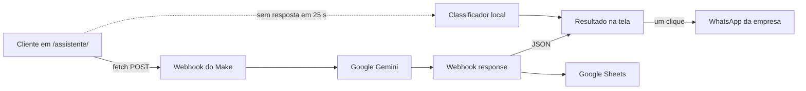

- As instruções da IA estão em [`make/prompt-gemini.txt`](make/prompt-gemini.txt): seis categorias de serviço, critérios de urgência e formato JSON obrigatório.
- A IA nunca informa preço, prazo ou garantia: a confirmação é sempre de um atendente.
- A chave do Gemini fica no Make. O navegador só conhece a URL do webhook.
- A resposta da IA entra na página por `textContent`, e só valores conhecidos são aceitos, o que impede a execução de HTML vindo da IA.

## 6. Responsividade e acessibilidade

- Serviços em 3 colunas no desktop, 2 no tablet e 1 no celular; menu hambúrguer no celular.
- *Container queries* nos blocos da página do assistente; alvos de toque com 48 px.
- HTML semântico, um H1 por página, `lang="pt-BR"`.
- Rótulos em todos os campos, erros com `aria-describedby` e `aria-invalid`, status com `role="status"`, foco levado ao resultado.
- Contraste mínimo de 4,5:1 (WCAG AA) em todas as cores.
- Lighthouse (Mobile): página principal com **96** em Acessibilidade e 100 em Boas práticas e SEO; página do assistente com **100** em Acessibilidade, Boas práticas e SEO.

## 7. Prints

| Página principal (desktop) | Página principal (celular, menu aberto) |
| --- | --- |
| 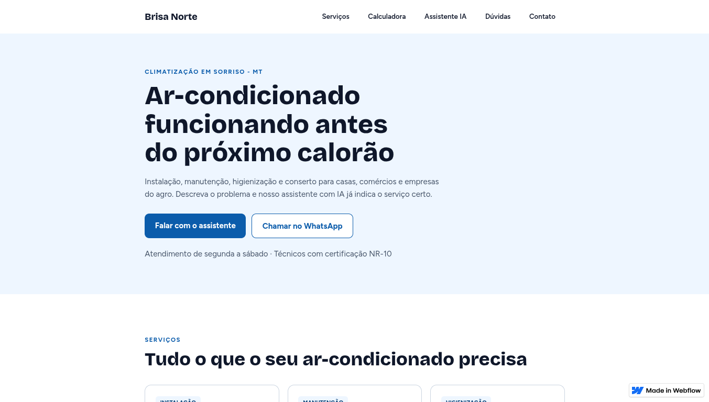 | 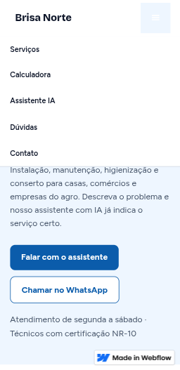 |

| Webflow Designer (Navigator) | Variáveis de cor no Webflow |
| --- | --- |
| 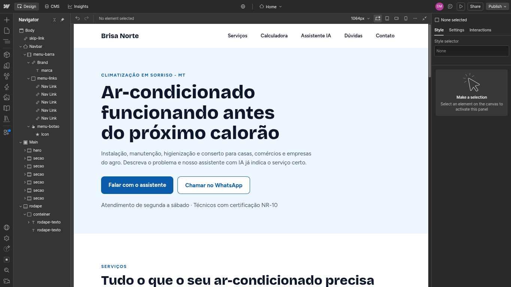 | 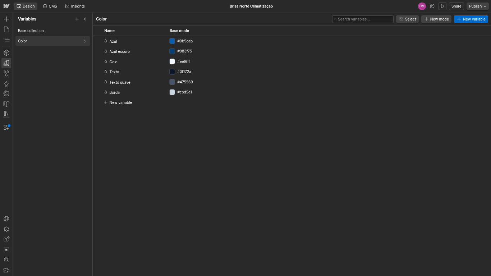 |

| Resultado do assistente com IA | Calculadora de BTUs |
| --- | --- |
| 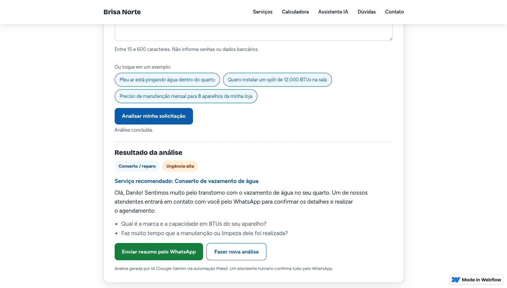 | 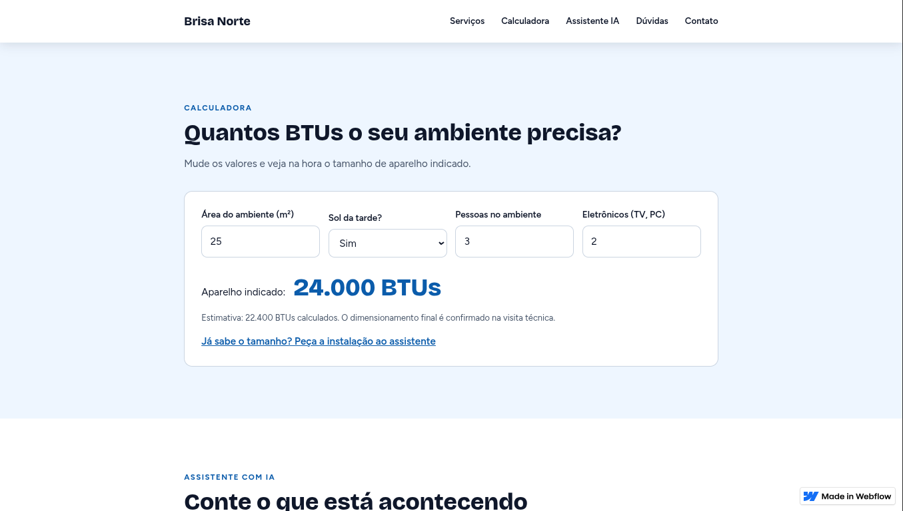 |

| WhatsApp com mensagem pronta | Cenário no Make |
| --- | --- |
| 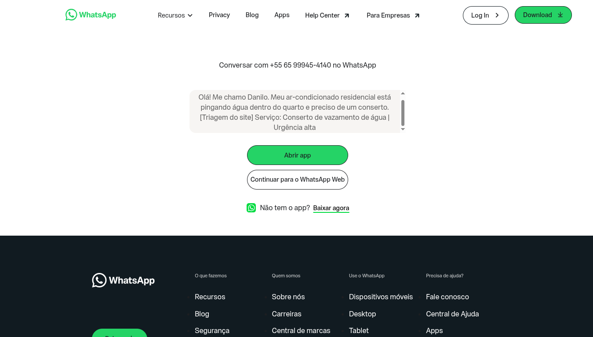 | 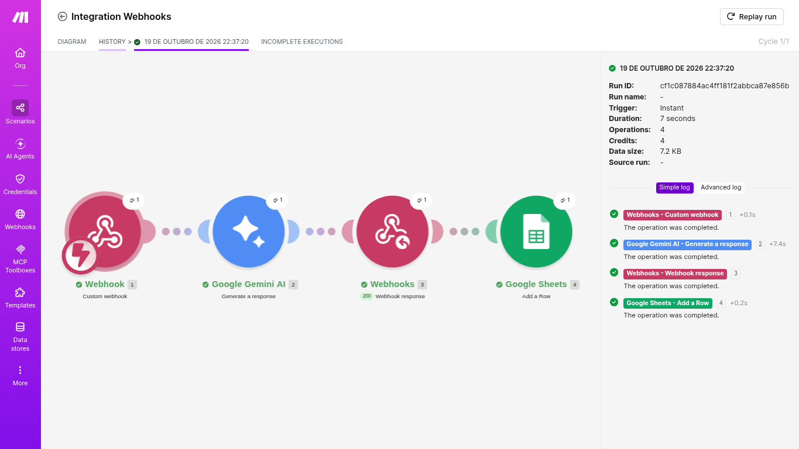 |

| Planilha de pedidos | App no Webflow Cloud |
| --- | --- |
| 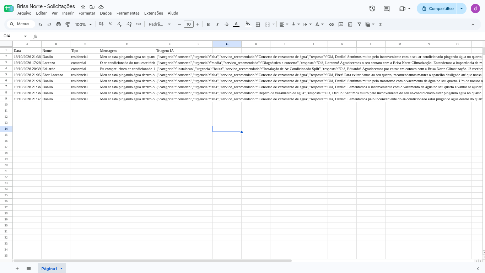 | 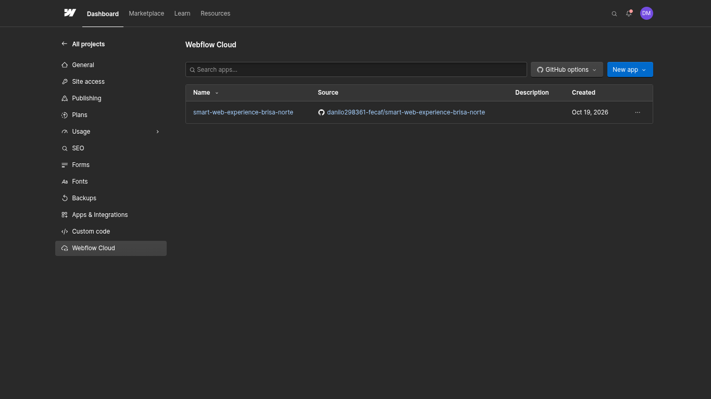 |

| Lighthouse da página principal (Mobile) | Lighthouse da página do assistente (Mobile) |
| --- | --- |
| 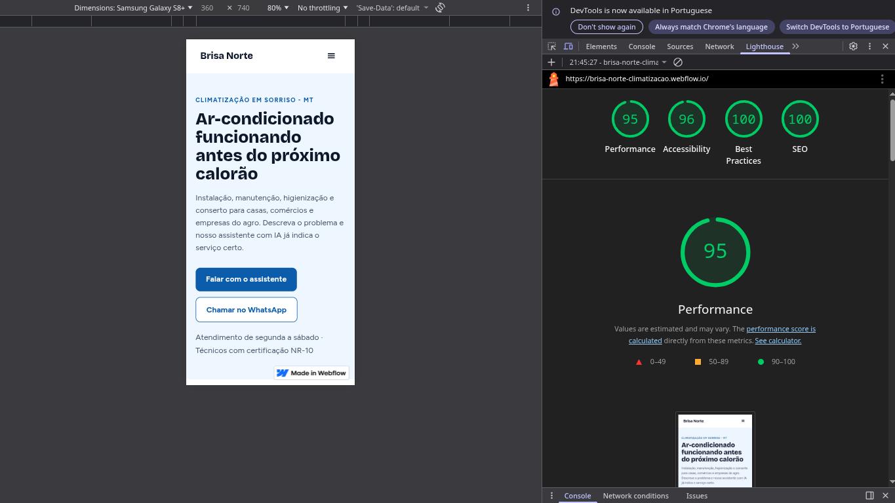 | 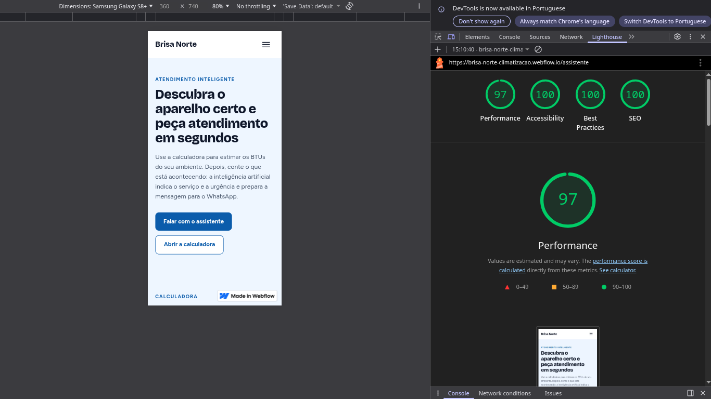 |

## 8. Como acessar e testar

1. Abra **https://brisa-norte-climatizacao.webflow.io** no computador ou no celular e navegue pelo menu.
2. Clique em **Falar com o assistente**: você vai para `/assistente/`.
3. **Calculadora:** informe 15 m², sem sol, 2 pessoas e 1 eletrônico. O resultado esperado é **12.000 BTUs**.
4. **Assistente:** toque num exemplo (ou escreva o seu), informe um nome e clique em **Analisar minha solicitação**.
5. Em alguns segundos aparecem categoria, urgência, serviço recomendado e o selo *Análise gerada por IA*.
6. Clique em **Enviar resumo pelo WhatsApp** para ver a mensagem pronta (abre o WhatsApp do atendimento).
7. **Teclado:** aperte Tab no início da página para ver o link "Pular para o conteúdo" e navegue só com Tab e Enter.

Para rodar a página do assistente no computador: `python3 -m http.server 4321` nesta pasta e abra `http://localhost:4321`.

## 9. Estrutura do repositório

```
├── index.html          ← página do assistente (publicada em /assistente/)
├── styles.css
├── app.js              ← constante CONFIG.WEBHOOK_URL aponta para o Make
├── 404.html
├── favicon.svg
├── make/
│   └── prompt-gemini.txt
└── prints/
```

Cada `push` na branch `main` publica a página do assistente automaticamente no Webflow Cloud.

## 10. Limitações e próximos passos

- A URL do webhook é pública por natureza; em produção, um back-end com limite de requisições protegeria a cota.
- O classificador local cobre só as palavras-chave mais comuns.
- A página principal mostra o selo "Made in Webflow" e usa o subdomínio `webflow.io` (plano gratuito).
- Próximos passos: agenda de horários integrada, painel de pedidos para a empresa e domínio próprio.
